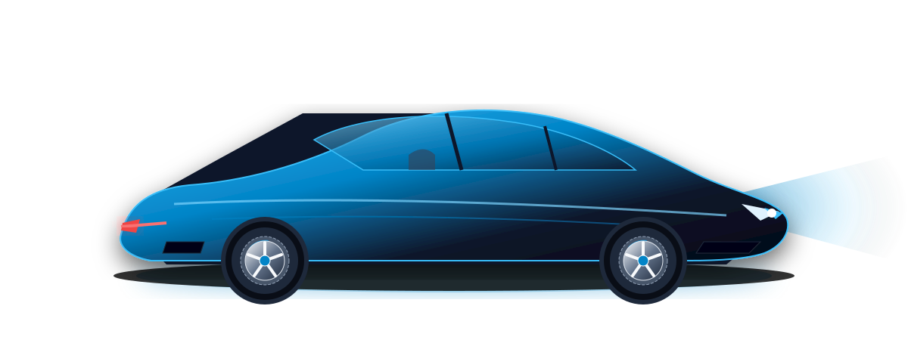

# 🚗 Scroll-Driven Hero Section Animation

A premium, smooth, and performant scroll-driven hero section animation built with **Next.js (App Router)**, **React**, **Tailwind CSS**, **GSAP + ScrollTrigger**, and **Lenis Smooth Scroll**.

Inspired by [paraschaturvedi.github.io/car-scroll-animation](https://paraschaturvedi.github.io/car-scroll-animation).



---

## ✨ Features

- **Full Viewport Above-The-Fold Layout**: Modern dark cyber aesthetic with custom atmospheric glows, speed lines, and grid patterns.
- **Staggered Headline Reveal**: "W E L C O M E   I T Z F I Z Z" rendered with individual accessibility-wrapped letter `<span>` elements (`aria-label` compliant).
- **Animated Impact Metrics**: Live counting-up numerical statistics (`58%`, `23%`, `27%`, `40%`) using GSAP proxies.
- **Scroll-Driven Car Motion**: Pinning ScrollTrigger scrub sequence where the car drives across the viewport with scale & pitch tilt effects.
- **Lenis Smooth Scroll**: Frame-synced smooth scrolling coupled directly to GSAP's ticker (`lagSmoothing(0)`).
- **Performance Optimized**: Uses strictly hardware-accelerated properties (`transform`, `opacity`), `will-change: transform`, and `force3D: true`.
- **Accessibility & Reduced Motion**: Automatically respects `prefers-reduced-motion` settings.

---

## 🛠️ Tech Stack

- **Framework**: Next.js 16 (App Router)
- **UI Library**: React 19
- **Styling**: Tailwind CSS v4
- **Animation**: GSAP 3 + ScrollTrigger
- **Smooth Scroll**: Lenis
- **Icons**: Lucide React

---

## 🚀 Quick Start

### 1. Clone the repository
```bash
git clone https://github.com/RohanKumarGupta/Scroll-Driven-Hero-Section-Animation.git
cd Scroll-Driven-Hero-Section-Animation
```

### 2. Install dependencies
```bash
npm install
```

### 3. Run development server
```bash
npm run dev
```

Open [http://localhost:3000](http://localhost:3000) in your browser to see the animation in action.

---

## 📂 Project Structure

```
├── app/
│   ├── globals.css          # Tailwind CSS v4 setup & custom scrollbar
│   ├── layout.js            # Root layout with Inter & Sora fonts
│   └── page.js              # Main page composing Hero & ContentSection
├── components/
│   ├── Hero.jsx             # Hero section with GSAP timeline & ScrollTrigger car animation
│   ├── SmoothScroll.jsx     # Lenis smooth scroll provider synced to GSAP ticker
│   └── ContentSection.jsx   # Filler content section below hero to showcase scrolling
├── public/
│   └── car.svg              # Transparent vector sports car graphic
```

---

## 🎬 Animation Logic Overview

### 1. Initial Load Animation (`introTl`)
- **Headline Stagger**: Letters reveal from `y: 40` to `y: 0` with `opacity: 1` (`stagger: 0.05`, `ease: "power3.out"`).
- **Stats Entrance**: Metric cards slide up (`stagger: 0.15`) while numbers count up from 0 to their target values.
- **Car Entrance**: Car slides smoothly from `xPercent: -50` to `0`.

### 2. Scroll-Driven Animation (`scrollTl`)
- **ScrollTrigger Pin**: Pins the hero container for `160%` viewport scroll distance.
- **Car Drive**: Car travels `65vw` across the screen with a `-2deg` pitch and `1.15x` scale interpolation.
- **Parallax Layers**: Headline letters expand and translate upward while road lines and speed markers streak across the background.

---

## ⚙️ Customization Guide

- **Swap Car Image**: Replace `/public/car.svg` with your own transparent PNG/SVG and update the `src` in `components/Hero.jsx`.
- **Adjust Scroll Distance**: Change `end: "+=160%"` in `components/Hero.jsx` (`+=200%` for longer scroll, `+=100%` for faster completion).
- **Scrub Inertia**: Tweak `scrub: 1` (e.g., `0.5` for instant tracking, `2` for heavier inertia).

---

## 📄 License

MIT © [RohanKumarGupta](https://github.com/RohanKumarGupta)
